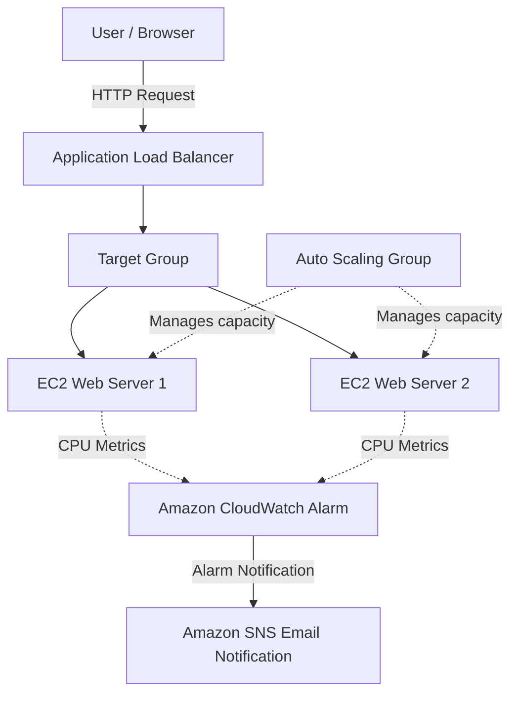

 AWS High Availability Web Application — Architecture

 Architecture Diagram

## How It Works

1. A user accesses the application through the Application Load Balancer DNS name.
2. The load balancer forwards requests to healthy EC2 instances registered in the target group.
3. The Auto Scaling Group maintains the configured instance capacity and can adjust it based on the scaling policy.
4. CloudWatch monitors CPU utilization and evaluates the configured alarm.
5. SNS sends an email notification when the alarm enters its configured alarm state and the notification action is triggered.

## Network Design

- VPC CIDR: `10.0.0.0/16`
- Public Subnet 1: `10.0.1.0/24`
- Public Subnet 2: `10.0.2.0/24`
- Load Balancer: Internet-facing, HTTP listener on port 80

**Note:** The diagram represents the intended project architecture. Actual Auto Scaling activity and email delivery depend on the configured policies, alarm state, and SNS subscription confirmation.
